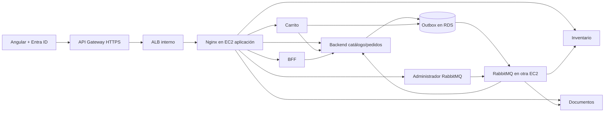

# Punto Gamer — EP2

Angular con Microsoft Entra ID, seis aplicaciones Spring Boot y un cluster RabbitMQ de tres nodos. Terraform despliega dos EC2: una para los contenedores de la aplicación y otra para RabbitMQ. RDS MySQL guarda productos, compras, carritos, eventos y comprobantes.

**Partir por [la guía de despliegue y pruebas](docs/EP2-puesta-en-marcha.md).** La matriz [pauta → código → evidencia](docs/EP2-matriz-pauta.md) permite revisar cada criterio. La colección [Postman](docs/postman/EP2-PuntoGamer.postman_collection.json) prueba la API administradora, incluido el nombre vacío (400).

| Aplicación | Carpeta | Puerto interno | Función |
|---|---|---:|---|
| Catálogo y pedidos | Backend | 8082 | Productos, usuarios Azure, compra, consumidor de pedidos |
| BFF | BffJava | 8084 | Agrega catálogo/categorías y perfil |
| Carrito | services/cart-service | 8085 | Carrito por identidad JWT, persistencia y checkout |
| Inventario | services/inventory-service | 8086 | Consumidor y auditoría de stock reservado |
| Documentos | services/notification-service | 8087 | Consumidor, comprobantes HTML por usuario |
| Administrador RabbitMQ | services/rabbit-admin-service | 8088 | CRUD de recursos y eventos de prueba |

`services/messaging-common` es una biblioteca compartida; no se cuenta como microservicio. Nginx sirve Angular y dirige las peticiones a cada aplicación. Las aplicaciones se ejecutan en contenedores independientes; no hace falta una EC2 por servicio. Los tres nodos RabbitMQ comparten su EC2, por lo que su tolerancia a fallas no cubre la pérdida de esa máquina.

Los nombres de mensajería están centralizados en `services/messaging-common/src/main/resources/messaging-defaults.properties` y se vinculan a una sola clase `@ConfigurationProperties`. Los tres consumidores usan confirmación manual, registro de errores, DLQ, reintentos acotados y deduplicación transaccional.

La compra usa precios del servidor, reserva stock mediante un UPDATE condicional y escribe los tres eventos en la misma transacción. El outbox conserva eventos si el broker no está disponible. El carrito conserva una clave de compra para reintentar sin generar otra boleta ante una respuesta perdida. Los comprobantes se generan y guardan en RDS; este proyecto no envía correos SMTP ni realiza cobros bancarios.

La migración `V2__cart_messaging_and_documents.sql` agrega las tablas y una clave nullable a boletas. V1 se conserva: Flyway actualiza la base existente al iniciar el Backend con perfil `aws`. No se ejecuta el seed automáticamente sobre los datos del usuario.

Para compilar Java: `./mvnw.cmd clean verify` en Windows, o `./mvnw clean verify` en Linux. Angular: desde `FrontendAngular`, `npm ci`, `npm test`, `npm run build`. Para la entrega AWS usar el script de la guía, que empaqueta Angular y los seis JAR y ejecuta Docker build en la EC2.

`Frontend/` conserva el frontend React anterior como referencia. El despliegue actual construye **FrontendAngular/**. El nombre `Frontend/dist` dentro del ZIP es solo la ruta que sirve Nginx; contiene la compilación Angular.

Estado de esta entrega: código y pruebas locales preparados. El despliegue real, el rol Azure y las capturas AVA deben comprobarse con la guía; una compilación local no acredita esos pasos.
