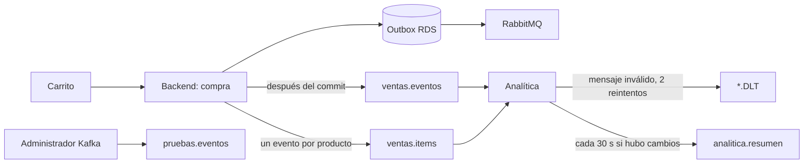

# EP3: Kafka, streaming y analítica en AWS

EP3 agrega streaming sobre el proyecto EP2. RabbitMQ sigue siendo el camino transaccional de la compra (outbox, ACK manual, DLQ). Kafka recibe una copia de cada venta para analítica en tiempo real.

## Qué se agregó

| Pieza | Carpeta | Puerto | Función |
|---|---|---:|---|
| Biblioteca Kafka | `services/kafka-common` | — | Nombres de topics, productor JSON, seguridad JWT de los servicios de streaming |
| Administrador Kafka | `services/kafka-admin-service` | 8089 | Brokers, topics, consumer groups, lectura de mensajes y eventos de prueba (AdminClient) |
| Analítica | `services/kafka-analytics-service` | 8090 | Consume ventas e items, agrega en memoria, deriva inválidos al DLT y publica el resumen |
| Productor | `Backend` (perfil `streaming`) | 8082 | Publica cada compra en Kafka después del commit de la base de datos |
| Cluster | `infra/terraform/kafka.tf` | 9092–9094 | EC2 propia con 3 nodos Zookeeper, 3 brokers `cp-kafka 7.9.0` y Kafka-UI |

Con esto hay **ocho aplicaciones Java** y tres EC2: aplicación, RabbitMQ y Kafka.

## Clúster: tres Zookeeper y tres brokers

| Nodo | Rol | Si uno cae |
| --- | --- | --- |
| `zookeeper-1..3` | Ensamble que guarda los metadatos: brokers vivos, quién es el controlador, topics y su configuración. Eligen un líder y replican cada cambio (puertos 2888 y 3888). | El quorum es 2 de 3: sigue funcionando. |
| `kafka-1..3` | Guardan y sirven los mensajes. Cada partición tiene un líder y dos seguidores en los otros brokers. | Un seguidor pasa a líder; con `min.insync.replicas=2` y `acks=all` no se pierden escrituras. |
| `kafka-ui` | Interfaz para administrar y supervisar brokers, topics, mensajes y consumer groups. | No afecta al clúster. |

## Topics

Los topics y su configuración viven en un solo archivo, `services/kafka-common/src/main/resources/kafka-defaults.properties`. Lo leen los servicios Java y Terraform. Todos tienen 3 particiones, factor de replicación 3 y `min.insync.replicas=2`: con `acks=all` un broker puede caer sin perder escrituras.

| Topic | DTO (valor) | Clave | Retención | Limpieza | Productor | Consumidor (grupo) |
|---|---|---|---|---|---|---|
| `ventas.eventos` | `VentaRegistradaEvent` | id de boleta | 7 días | delete | Backend | Analítica (`analitica-ventas`) |
| `ventas.items` | `ProductoVendidoEvent` | id de producto | 7 días | delete | Backend | Analítica (`analitica-productos`) |
| `ventas.eventos.DLT` | mensaje original | la original | 14 días | delete | Manejador de errores | Analítica (`analitica-dlt`) |
| `ventas.items.DLT` | mensaje original | la original | 14 días | delete | Manejador de errores | Analítica (`analitica-dlt`) |
| `analitica.resumen` | `ResumenAnaliticaEvent` | `resumen` | 7 días | **compact** | Analítica | Kafka-UI / lectura manual |
| `pruebas.eventos` | texto libre | libre | 1 día | delete | Administrador Kafka | Kafka-UI / lectura manual |

La clave decide la partición: todos los eventos de un mismo producto quedan ordenados en la misma partición. Por qué cada valor:

- **Ventas e items, 7 días.** La analítica guarda sus totales en memoria y los reconstruye releyendo estos topics al arrancar; una semana cubre cualquier reinicio del laboratorio.
- **DLT, 14 días.** Un mensaje rechazado necesita tiempo para investigar la causa antes de perderse.
- **Resumen, compactado.** Siempre se publica con la misma clave; la compactación conserva solo el último resumen, que es lo único útil.
- **Pruebas, 1 día.** Mensajes manuales que no tienen valor después de la demostración.

Los topics los crea `kafka-cloud-init` en la EC2 y también los servicios al arrancar (`KafkaAdmin`). El administrador Kafka aplica la configuración declarada a los topics existentes al iniciar, y se puede volver a aplicar con `POST /api/kafka/topics/sync-config`.

## Cliente Kafka y DTO

- **Eventos tipados.** `kafka-common/.../events` define tres records: `VentaRegistradaEvent`, `ProductoVendidoEvent` y `ResumenAnaliticaEvent`, con Bean Validation (`@NotNull`, `@Positive`, `@Pattern`…). El productor valida antes de enviar; el consumidor valida después de leer.
- **Serializers.** Claves con `StringSerializer`. Valores con `EventJsonSerializer`, que escribe cada DTO como JSON UTF-8 y deja pasar texto sin cambios (necesario para reenviar al DLT el mensaje original). Los consumidores leen texto (`StringDeserializer`) y lo convierten a su DTO en `SalesStreamConsumer.parse`; así un JSON roto llega al manejador de errores en vez de bloquear la partición.
- **Productor (Backend, perfil `streaming`).** `acks=all`, idempotencia, 5 reintentos, compresión gzip, `linger.ms=5` y tiempos máximos cortos para que un Kafka caído no bloquee una compra. Ver `Backend/src/main/resources/application-streaming.properties`.
- **Consumidores (analítica).** Offsets confirmados manualmente por registro (`ack-mode=record`, sin autocommit), `read_committed`, `CooperativeStickyAssignor` y `concurrency=3`. Ver `kafka-analytics-service/src/main/resources/application.properties`.
- **Separación de capas.** `SalesStreamConsumer` solo lee, convierte y valida; la lógica de negocio está en `AnalyticsState`, que no depende de Kafka.

## Consumer groups

| Grupo | Topics | Hilos | Responsabilidad |
|---|---|---:|---|
| `analitica-ventas` | `ventas.eventos` | 3 | Ventas, ingresos, ticket promedio |
| `analitica-productos` | `ventas.items` | 3 | Ranking de productos y stock bajo |
| `analitica-dlt` | los dos DLT | 3 | Registro de mensajes rechazados |

Cada grupo recibe todos los eventos de sus topics de forma independiente: dividir responsabilidades en grupos distintos permite que una falla en el ranking de productos no frene el conteo de ventas. Dentro de un grupo los tres hilos se reparten las tres particiones; si se levanta una segunda instancia del servicio, Kafka rebalancea y las particiones se reparten entre ambas. `GET /api/kafka/consumer-groups/{id}` muestra qué partición tiene cada miembro.

## Manejo de errores

1. `SalesStreamConsumer` convierte el JSON a su DTO y lo valida. Si falla, registra `[KAFKA CONSUMER ERROR]` con topic, partición, offset y clave, y lanza la excepción.
2. `DefaultErrorHandler` decide: un payload inválido (`IllegalArgumentException`) **no se reintenta**, porque nunca se corregirá solo; cualquier otra falla se reintenta **dos veces** con un segundo de espera (`[KAFKA RETRY]` en el log).
3. `DeadLetterPublishingRecoverer` publica el mensaje original en el DLT, en la misma partición, con la causa en las cabeceras. El consumidor sigue con el siguiente mensaje.
4. El grupo `analitica-dlt` registra cada rechazo (`[KAFKA DLT]`) y lo suma al panel.
5. Del lado del productor, un evento que no pasa la validación no se envía, y un fallo de Kafka se registra sin afectar la compra ya confirmada.



## Rutas

Todas pasan por Nginx en el mismo dominio. Salvo los `/health`, exigen un JWT de Entra ID con el rol **Rabbit.Admin** (sin token responden 401).

| Ruta | Servicio |
|---|---|
| `GET /health/kafka-admin` | `{"status":"UP","brokers":3,...}` |
| `GET /health/analytics` | `{"status":"UP",...}` |
| `GET /api/kafka/cluster` | Brokers y controlador |
| `GET /api/kafka/topics` · `POST` · `DELETE /api/kafka/topics/{nombre}` | Listar (con retención y limpieza), crear con configuración inicial y eliminar (los seis de negocio están protegidos) |
| `GET` · `PUT /api/kafka/topics/{nombre}/config` | Ver y modificar `retention.ms`, `cleanup.policy`, `min.insync.replicas` y otras cinco propiedades permitidas |
| `DELETE /api/kafka/topics/{nombre}/config/{propiedad}` | Devolver una propiedad al valor por defecto del broker |
| `POST /api/kafka/topics/{nombre}/partitions` | Aumentar particiones `{"count":6}` |
| `POST /api/kafka/topics/sync-config` | Reaplicar la configuración de `kafka-defaults.properties` a los seis topics |
| `GET /api/kafka/topics/{nombre}/messages?limit=10` | Últimos mensajes, sin alterar a los consumidores |
| `GET /api/kafka/consumer-groups` | Estado, miembros y lag por grupo |
| `GET /api/kafka/consumer-groups/{id}` | Miembros, partición asignada a cada uno y offset/lag por partición |
| `POST /api/kafka/consumer-groups/{id}/offsets` | Mover offsets a `earliest` o `latest` (solo con el grupo detenido) |
| `POST /api/kafka/events` | Publica un mensaje de prueba `{topic, message}` |
| `GET /api/analytics/panel` · `/resumen` · `/productos` · `/stock-bajo` · `/ventas` · `/dlt` | Analítica |
| `GET /api/streaming/estado` · `POST /api/streaming/eventos` | Backend: `{"modo":"venta"}` o `{"modo":"invalido"}` |

En la web: **Administración → Kafka y analítica**.

## Desplegar

Requisitos en el PC: AWS CLI v2, Terraform ≥ 1.11, JDK 17 o 21, Node 22 o superior, y conexión a Internet (Maven y npm descargan dependencias).

1. Iniciar el Learner Lab y copiar las credenciales (AWS Details → AWS CLI) a `C:\Users\<usuario>\.aws\credentials`. Cambian en cada inicio del lab.
2. Revisar `infra/terraform/terraform.tfvars`: `aws_account_id` debe ser la cuenta que muestra `aws sts get-caller-identity`. Ese archivo no se sube a Git; si falta, copiar `terraform.tfvars.example`.
3. Desde la raíz del repositorio, en PowerShell:

```powershell
Set-ExecutionPolicy -Scope Process -ExecutionPolicy Bypass
aws sts get-caller-identity
.\infra\deploy\Start-LabProject.ps1
```

El script compila y prueba los ocho módulos y Angular, genera el plan, lo revisa y lo aplica. Después espera hasta 25 minutos a que la web responda y ejecuta `Verify-Project.ps1`. En una cuenta nueva crea todo desde cero. Sobre un despliegue existente:

- `-AllowApplicationReplacement` permite reemplazar la EC2 de aplicación (necesario al cambiar de versión).
- `-AllowKafkaReplacement` permite reemplazar la EC2 de Kafka. **Se pierden los mensajes de los topics**; usar solo si cambió `kafka-compose.yml` o `kafka-cloud-init.sh.tftpl` (por ejemplo, el paso de 1 a 3 nodos Zookeeper).
- `-SkipBuild` reutiliza `infra/.deploy/application.zip` sin recompilar.

4. Registrar la URL que imprime el script como **Redirect URI de tipo SPA** en Entra ID (PuntoGamer-Frontend → Authentication), con `/` al final. Sin eso el inicio de sesión falla. El rol `Rabbit.Admin` se asigna como en EP2 (`docs/EP2-puesta-en-marcha.md`, sección 1).

**No borrar `infra/terraform/terraform.tfstate`.** Sin ese archivo Terraform no reconoce lo ya creado. `Start-LabProject.ps1` guarda una copia en `infra/.deploy/state-backups/` en cada ejecución; conviene respaldarlo también fuera del PC.

Al reiniciar el Learner Lab las tres EC2 vuelven a encenderse solas y los servicios `systemd` levantan los contenedores; no hace falta redesplegar. Kafka conserva sus topics en volúmenes Docker.

## Evidencias

1. **Salud.** Abrir `<URL>/health/kafka-admin`: debe mostrar `"brokers":3`. Abrir `<URL>/health/analytics`.
2. **Infraestructura.** Consola EC2: `punto-gamer-dev-kafka` en ejecución y su security group con 9092–9094 solo desde el grupo del backend.
3. **Cluster por terminal.** EC2 → instancia Kafka → Conectar → Session Manager:

```bash
K=/opt/punto-gamer/kafka/compose.yml
sudo docker compose -f $K ps
sudo docker compose -f $K exec kafka-1 kafka-topics --bootstrap-server kafka-1:29092 --describe
sudo docker compose -f $K exec kafka-1 kafka-consumer-groups --bootstrap-server kafka-1:29092 --describe --all-groups
```

4. **Kafka-UI.** Con AWS CLI y Session Manager Plugin en el PC, ejecutar el comando `kafka_ui_tunnel_command` de `terraform output` y abrir `http://localhost:8095`.
5. **Compra real.** Iniciar sesión, comprar un producto y revisar Administración → Kafka y analítica: suben *Ventas procesadas* y *Unidades vendidas*; **Leer ventas.eventos** muestra el evento con su partición y offset.
6. **Consumer groups.** Botón **Ver consumer groups**: `analitica-ventas`, `analitica-productos` y `analitica-dlt` en estado `Stable` y lag 0.
7. **DLT.** Botón **Enviar inválido al DLT**. En los logs de analítica aparecen `[KAFKA CONSUMER ERROR]` y `[KAFKA DLT]`; unos segundos después sube *Mensajes en DLT* y **Leer DLT** muestra el mensaje original.

```bash
# En la EC2 de aplicación (Session Manager)
A=/opt/punto-gamer/application/compose.yml
sudo docker compose -f $A logs --tail 50 analytics
sudo docker compose -f $A logs --tail 200 backend | grep KAFKA
```

8. **Configuración de topics.** La tabla de topics muestra retención y limpieza. Escribir `pruebas.eventos`, poner 2 días y **Guardar configuración**: la tabla cambia a `2 d`. **Aplicar configuración declarada** la devuelve a 1 día. En Kafka-UI → Topics → `analitica.resumen` → Settings se ve `cleanup.policy=compact`.
9. **Balanceo.** Elegir `analitica-ventas` y **Ver miembros y particiones**: tres miembros, una partición cada uno.
10. **Tolerancia a fallas.** En la EC2 de Kafka, `sudo docker compose -f /opt/punto-gamer/kafka/compose.yml stop kafka-2`; la web sigue publicando y consumiendo (quedan 2 réplicas en sincronía). `/health/kafka-admin` muestra `"brokers":2`. Volver a iniciarlo con `start kafka-2`. Lo mismo con `stop zookeeper-2`: el ensamble mantiene quorum con dos nodos.
11. **CloudWatch.** Métricas de CPU y red de las tres EC2 durante la prueba.

## Decisiones y límites

- **RabbitMQ y Kafka juntos.** RabbitMQ entrega cada mensaje a un consumidor que debe actuar (reservar stock, generar el comprobante). Kafka guarda un registro ordenado que varios grupos pueden releer; por eso se usa para analítica.
- **Publicación después del commit.** El Backend envía a Kafka cuando la compra ya está confirmada en RDS. Si Kafka no responde, la compra no falla: el error queda en el log y el evento se pierde para analítica. No hay outbox para Kafka.
- **Analítica en memoria.** No usa base de datos. Al arrancar relee los topics desde el inicio y reconstruye los totales; un registro del offset aplicado por partición evita contar dos veces. Sirve para el volumen de esta demostración, no para millones de eventos.
- **Una sola EC2 para el clúster.** Tolera la caída de un broker y de un nodo Zookeeper, no la de la máquina; en producción cada nodo iría en su propia máquina o zona.
- **Sin TLS ni SASL entre la aplicación y Kafka.** El acceso se restringe por security group dentro de la VPC.
- **Servicios de streaming sin secretos.** `kafka-admin` y `analytics` reciben solo la dirección de Kafka y la configuración JWT; no las claves de RDS ni de RabbitMQ.

## Kafka local

```powershell
docker compose --env-file infra/local/kafka-local.env -f infra/terraform/templates/kafka-compose.yml up -d
```

Brokers en `localhost:9092,9093,9094` y Kafka-UI en `http://localhost:8095`. Los servicios crean los topics al arrancar. Para que el Backend publique, activar el perfil: `SPRING_PROFILES_ACTIVE=<perfil de base de datos>,streaming`.
